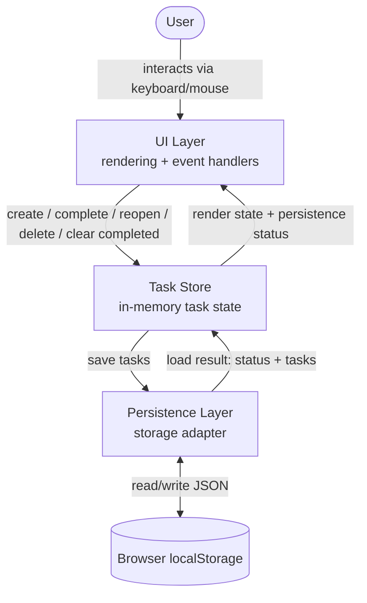

# Architecture: Todo Task Management

## 1. Architecture Overview

A single-page, client-only web application. Entirely static HTML/CSS/vanilla JavaScript, no framework, no build step, no package manager. All task state lives in the browser; persistence uses the Web Storage API (`localStorage`). No server, backend, network calls, or external services of any kind.

## 2. Architectural Drivers

- FR-11–FR-14 (persistence + defined failure modes) → requires an isolated storage/persistence responsibility with explicit error paths.
- FR-3, FR-10 (unique IDs, duplicate titles allowed) → task identity must be independent of title.
- FR-4 (newest-first ordering) → list order is insertion order, not derived/sorted.
- NFR-3 (simplicity) → no framework/build step (confirmed decision).
- NFR-4–NFR-8 (accessibility/responsiveness) → native controls, natural tab order, managed focus, flexible layout.
- NFR-9 (safe rendering) → titles must never be parsed as markup.
- Constraints (no backend/auth/services) → purely client-side system boundary.

## 3. System Boundary

**In system:** browser-rendered HTML/CSS/JS application; the Web Storage API (`localStorage`) within the user's browser.

**Outside system:** no server, no database, no network calls, no third-party services, no accounts/authentication.

## 4. Technology Choices

- HTML5, CSS3, vanilla JavaScript. No framework, no bundler, no package manager, no build step, no TypeScript.
- Persistence via `window.localStorage`.
- Delivered as static files — can be opened directly or served by any static file host; no server-side logic exists.

**Rationale:** directly satisfies NFR-3 and `CLAUDE.md`'s scope-control rule against unnecessary frameworks/infrastructure; confirmed by human decision during the Architecture phase.

## 5. High-Level Architecture

Three logical responsibilities within one page (not necessarily separate files, though they may be for readability):

1. **UI Layer** — renders the list and controls, handles user input events, updates the DOM.
2. **Task Store** — holds the in-memory array of tasks; exposes create/complete/reopen/delete/clear-completed operations that enforce FR-1–FR-10 and FR-15.
3. **Persistence Layer** — wraps `localStorage` access; implements load/save and the FR-12–FR-14 error conditions.

Flow: UI events → Task Store operation → Task Store tells UI to re-render → Task Store asks Persistence Layer to save. On startup: Persistence Layer reads and validates storage → Task Store initializes from the result: an absent key is a normal `ok` first-run case, producing an empty task list without being treated as an error, while malformed or unavailable storage produces an empty in-memory task list together with the appropriate persistence notice → UI renders.

## 6. Component Diagram



## 7. Component Responsibilities

- **UI Layer:** renders the newest-first list and completed indicator; wires up create/complete/reopen/delete interactions; manages focus per NFR-7; uses semantic, keyboard-accessible native elements (NFR-4–NFR-6); renders titles as text only (NFR-9); responsive layout (NFR-8); renders a single, non-blocking notice line reflecting the Task Store's current `persistenceStatus` (hidden when status is `ok`).
- **Task Store:** owns the canonical task list; generates unique IDs (FR-3); validates titles before creating (FR-2); inserts newest-first (FR-4); performs complete/reopen/delete by ID (FR-7–FR-9); removes all completed tasks in a single operation (FR-15); treats same-titled tasks as fully independent (FR-10); calls the Persistence Layer's `load()` once at startup and `save()` after every mutation; stores the single most recent status value returned by each call as `persistenceStatus`, for the UI to read.
- **Persistence Layer:** exposes exactly two operations, `load()` and `save(tasks)`, each returning a small plain result object (no custom classes, no events) — see Section 10.

## 8. Data Flow

- **Create:** UI reads input → Store validates → assigns ID → prepends to list → Store calls `save(tasks)`, records the returned status → UI re-renders list and notice, refocuses the input.
- **Load (startup):** Store calls `load()` → records the returned status and tasks → UI renders the resulting list (empty or loaded) and any notice implied by the status.
- **Complete/Reopen:** UI triggers by task ID → Store toggles that task's state → Store calls `save(tasks)`, records status → UI updates that task's indicator and the notice.
- **Delete:** UI triggers by task ID → Store removes it → Store calls `save(tasks)`, records status → UI removes it from the DOM, refocuses the input, updates the notice.
- **Clear Completed:** UI triggers (control enabled only when ≥1 completed task exists) → Store filters out all completed tasks → Store calls `save(tasks)`, records status → UI removes the cleared items from the DOM, refocuses the input, updates the notice, and disables the control (no completed tasks remain).

## 9. Data Model / Key Data Structures

```
Task = { id: string, title: string, completed: boolean }
```

Stored form: one `localStorage` key holding a JSON-serialized array of `Task`, in the same newest-first order shown in the UI (array order doubles as display order, satisfying FR-4 and FR-11 together).

## 10. Persistence Architecture

**Storage:** one dedicated `localStorage` key (e.g., `todo.tasks.v1`) holding a JSON-serialized array of `Task`.

**Persistence Layer contract** (two plain operations, no additional abstraction):

- `load()` → returns `{ status, tasks }`, where `status` is exactly one of:
  - **`"ok"`** — either the key held a value that parsed and validated as an array of well-formed `Task` objects (`tasks` = that array), or the key was simply absent (`tasks` = `[]`), which is the normal first-run case, not an error.
  - **`"unavailable"`** — the attempt to read `localStorage` itself failed (e.g., `localStorage` is not defined, or accessing/calling it threw, as can happen when storage is disabled or blocked). `tasks` = `[]`.
  - **`"malformed"`** — `localStorage` was reachable and a value existed under the key, but that value failed `JSON.parse` or did not match the expected shape (an array of objects each with a string `id`, string `title`, boolean `completed`). `tasks` = `[]`. In this case the existing stored value is left exactly as-is; `load()` performs no write.

  These three are distinguished sequentially, not by inference: the read call is attempted first (a throw there, or the API being absent, is `"unavailable"`); only if that read succeeds is the returned value parsed and validated (a failure there is `"malformed"`); a successful read returning `null` is `"ok"` with an empty list.

- `save(tasks)` → returns `{ status }`, where `status` is exactly one of:
  - **`"ok"`** — the single `setItem` call completed without throwing.
  - **`"failed"`** — the single `setItem` call threw (e.g., quota exceeded, storage disabled after startup, private-mode restrictions).

**Status propagation:** the Task Store stores only the single latest status value (`persistenceStatus`) after each `load()`/`save()` call; the UI reads that one value to show or hide its one notice line. No event bus, observer, or separate status service is introduced — this is a plain return value read once per call.

## 11. Error/Failure Handling

- **Storage unavailable at startup (`load()` → `"unavailable"`):** the Task Store initializes with an empty in-memory list and sets `persistenceStatus` to `"unavailable"`; the UI shows a notice (e.g., "Changes won't be saved in this browser"). Subsequent `save()` calls will also be attempted and will themselves report their own status (typically `"failed"`, since the same access problem generally applies to writes too); the application does not skip attempting them.
- **Malformed/unreadable existing data (`load()` → `"malformed"`):** the Task Store initializes with an empty in-memory list and sets `persistenceStatus` to `"malformed"`; the UI shows a notice (e.g., "Saved tasks could not be loaded"). Critically, `load()` itself never calls `setItem` — the existing stored bytes are left untouched at this point. The stored key is only overwritten later, as an ordinary consequence of the user's next create/complete/reopen/delete action triggering a normal `save()` call with that action's valid resulting data — the application does not perform any automatic "repair" or "reset" write on its own initiative.
- **Write/save failure (`save(tasks)` → `"failed"`):** the thrown exception from `setItem` is caught; the Task Store's in-memory list is not modified or rolled back as a result — it continues to reflect the user's most recent action exactly as before the save attempt. `persistenceStatus` is set to `"failed"` and the UI shows a notice (e.g., "Latest change couldn't be saved"). No automatic retry is performed.

**Precision on "no partial write" (scoped to what the application controls):**

- The application's own guarantee is at the application level, not the browser-internals level: for any single `save()` call, the application performs exactly one `JSON.stringify` + one `setItem` call over the complete, currently-valid in-memory task list — it never writes tasks incrementally or writes a value it knows to be incomplete or invalid. This means there is no *application-level* partial write (i.e., the app itself never issues a sequence of writes that could leave storage in a mixed state).
- Separately, and outside the application's control or visibility: when `setItem` throws, the browser/OS-level outcome for the underlying storage value (left unchanged, or something else) is an implementation detail of the browser that the Storage API does not report and this architecture makes no claim about. The application does not attempt to detect, verify, or correct that outcome — it only knows the call threw, treats that as `"failed"`, and keeps showing the user their last-known in-memory state (previous bullet).
- The application also never intentionally issues a `save()` with data that would replace known-good stored data with data it has reason to believe is invalid — the only writes performed are ordinary `save()` calls following a validated, successful user action.

## 12. Security Considerations

- NFR-9: task titles are inserted into the DOM using text-only APIs (e.g., `textContent`), never `innerHTML`, so a title can never be parsed as HTML/script.
- No network calls, no external services, no credentials — minimal attack surface by construction (Constraints).
- `localStorage` is same-origin, client-only, and holds no sensitive data (only task titles/state), consistent with the no-auth constraint.

## 13. Accessibility/Responsiveness Considerations

- NFR-4: native `<input>` for title entry, a native checkbox-type control for complete/reopen, a native `<button>` for delete, a native `<button>` for clear-completed.
- NFR-5/NFR-6: natural DOM order (input, then list items top-to-bottom, then clear-completed control) gives a correct tab order without custom `tabindex` management.
- NFR-7: after create, focus is programmatically returned to the title input; after delete or clear-completed, focus is programmatically moved to the title input (chosen as the single predictable target in all three cases).
- NFR-8: a simple, relative-unit, flex/stack layout adapts to mobile widths without a separate mobile-specific template.

## 14. Architecture Decisions and Rationale

- **AD-1:** Vanilla HTML/CSS/JS, no framework/build step — confirmed decision; satisfies NFR-3 and `CLAUDE.md` scope control.
- **AD-2:** Three-responsibility separation (UI / Task Store / Persistence) — isolates error handling and identity/ordering rules from rendering, without a module system or build tooling.
- **AD-3:** Single `localStorage` key, array order = display order — simplest mechanism satisfying FR-4 and FR-11 together.
- **AD-4:** The application guarantees, at the application level, that it never issues a write intended to replace valid stored data with data it knows or suspects to be invalid (FR-13's "no automatic overwrite" is implemented by `load()` never writing, per Section 11). The application makes no claim about browser-internal behavior of a thrown `setItem` (FR-14); it only guarantees that a failed save does not alter the in-memory state the user sees (Section 11).
- **AD-5:** Text-only rendering of titles — directly implements NFR-9.
- **AD-6:** The Persistence Layer's `load()`/`save()` return plain `{status, ...}` objects with a fixed, small set of string values — no custom error classes, event system, or status-tracking component is introduced; the Task Store simply retains the latest value.
- **AD-7:** Clear Completed reuses the existing Task Store/Persistence contract unchanged — implemented as an array filter followed by the same `save(tasks)` call already used by every other mutation; no new component, persistence shape, or status value is introduced.

## 15. Constraints

- No backend/server.
- No authentication or user accounts.
- No external services.
- No categories, priorities, due dates, reminders, or search.
- No framework or build step (per confirmed decision).
- No application-defined maximum task count.

## 16. Risks and Trade-offs

- **Risk:** `localStorage` has a per-origin size quota; with no maximum task count required, a very large list could eventually hit it — surfaced as `save()` → `"failed"` rather than prevented. Accepted, per requirements.
- **Risk:** `localStorage` is per-browser/per-device with no cross-device sync — consistent with the no-accounts/no-sync constraint.
- **Risk:** the precise internal outcome of a thrown `setItem` (e.g., whether the browser left the previous value unchanged) is not observable through the Storage API and is not asserted by this architecture; the application's guarantees are limited to what it controls (single, validated write attempts; unmodified in-memory state on failure), as detailed in Section 11.
- **Trade-off:** manual DOM updates without a framework — reasonable for this small, fixed-scope list (NFR-3).
- **Trade-off:** no build step means no TypeScript checking or bundling — acceptable given the project's demonstration purpose.

## 17. Requirements Traceability

| Requirement(s) | Addressed by |
|---|---|
| FR-1, FR-2 | Task Store (create + validation), §7, §8 |
| FR-3 | Task Store ID generation, §9, AD-3 |
| FR-4 | Task Store insertion order = array/display order, §9, AD-3 |
| FR-5, FR-6 | UI Layer rendering, §7 |
| FR-7, FR-8, FR-9 | Task Store operations by ID, §8 |
| FR-10 | Task Store independence-by-ID, §7 |
| FR-15, AC-19 | Task Store filter operation, §7, §8, AD-7 |
| FR-11 | Persistence Layer `load()`/`save()`, §10 |
| FR-12 | `load()` → `"unavailable"`, §10, §11 |
| FR-13 | `load()` → `"malformed"`, §10, §11, AD-4 |
| FR-14 | `save()` → `"failed"`, §10, §11, AD-4 |
| NFR-1, NFR-2 | UI Layer direct interaction/immediate re-render, §7 |
| NFR-3 | AD-1, §4 |
| NFR-4, NFR-5, NFR-6 | §13 |
| NFR-7 | §13, UI focus management |
| NFR-8 | §13, responsive layout |
| NFR-9 | §12, AD-5 |
| Constraints/Scope/Out of Scope | §3, §15 |

## 18. Architecture Quality Checklist

- [x] Every decision traces to a requirement, constraint, or a confirmed human answer.
- [x] No product requirement was added, removed, or reinterpreted.
- [x] Architecture is proportionate to an intentionally simple Todo app.
- [x] Component/system diagram included (Mermaid).
- [x] Data flow defined for every major functional requirement.
- [x] Risks and trade-offs documented, without unsupported claims about `localStorage` internals.
- [x] No implementation-level coding tasks included.
- [x] Storage failure boundaries (unavailable / malformed / write-failure) precisely distinguished with a simple, plain status contract.
- [x] Human approval obtained prior to creation of this document.
